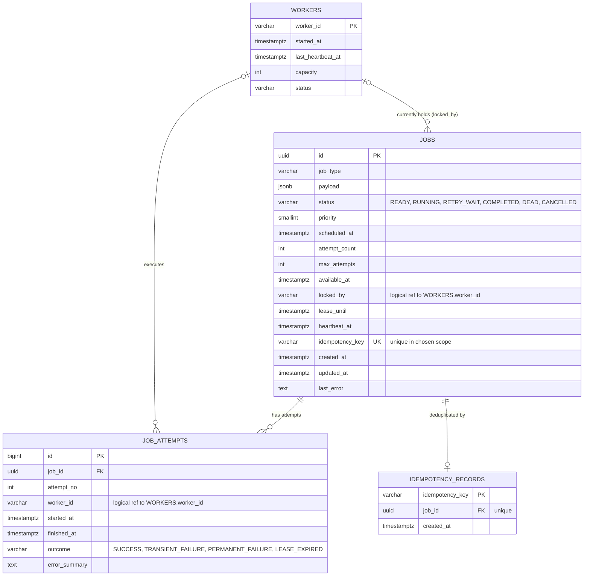

# TaskForge ER Diagram

GitHub renders the Mermaid block below automatically. Place this file at `docs/er-diagram.md`.

## Notes

- `WORKERS` and `IDEMPOTENCY_RECORDS` are optional in v1. Heartbeat can live on `JOBS`, and a UNIQUE constraint on `jobs.idempotency_key` can replace `IDEMPOTENCY_RECORDS`.
- `locked_by` and `job_attempts.worker_id` are logical references, not hard foreign keys, so a job's history survives a worker row being removed.
- `UNIQUE (job_id, attempt_no)` on `JOB_ATTEMPTS` prevents duplicate attempt rows.
- Indexes: `(status, available_at, priority)` for claiming; `(status, lease_until)` for recovery.
- CHECK constraints: `attempt_count >= 0`, `max_attempts > 0`.
